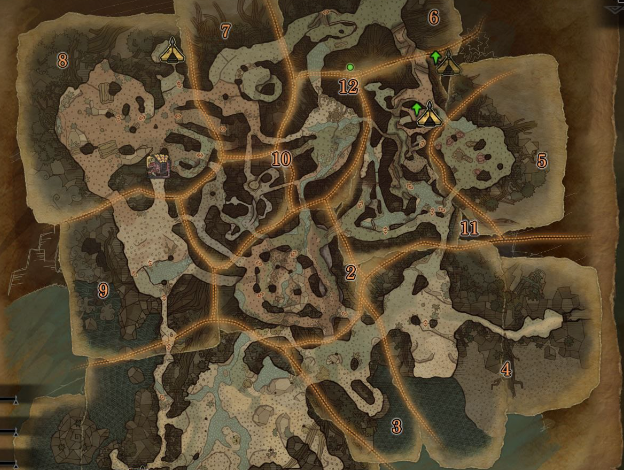

# Monster Hunter Maps 🗺️

[**🎮 Abrir demo pública**](https://raulwad13.github.io/Personal_Project_React/)

> **Demo publicada en GitHub Pages:** consulta un catálogo de 58 monstruos sin instalar nada ni conectar MongoDB. La publicación se automatiza con GitHub Actions.

Proyecto fullstack de exploración de biomas y consulta de monstruos de Monster Hunter, desarrollado como trabajo final de bootcamp.

## Vista previa

Las siguientes imágenes proceden de los recursos incluidos en el proyecto. Son **ilustraciones originales del repositorio**, no capturas de pantalla de la aplicación.

| Exploración de regiones | Ficha de monstruo |
|:--:|:--:|
|  |  |
| Selecciona un bioma y consulta sus monstruos. | Abre una ficha con imagen, hábitats y debilidades. |

**[▶ Probar la demo interactiva](https://raulwad13.github.io/Personal_Project_React/)** · Funciona desde el navegador del móvil.

## Cómo funciona

1. Selecciona un bioma en la galería de mapas ilustrados.
2. Consulta los monstruos que viven allí y utiliza el buscador para filtrarlos por nombre.
3. Pulsa sobre un monstruo para ver su ficha con imagen, especie, tipo, descripción, hábitats y debilidades elementales con estrellas.
4. Vuelve al listado de monstruos o cambia de región con los controles de navegación móvil.

**Estado:** demo React publicada en GitHub Pages, con mapas ilustrados, imágenes de monstruos, búsqueda, fichas de debilidades y navegación adaptada a móvil. La integración con Express y MongoDB sigue disponible para desarrollo. La demo pública es de consulta y utiliza datos locales; el mapa es una galería visual de regiones, no un mapa geográfico interactivo.

## Tecnologías

- React y Vite: interfaz.
- Node.js y Express: API REST.
- MongoDB y Mongoose: datos de los monstruos.

## Ejecutar en local

Requisitos: Node.js y npm. MongoDB es **opcional para consultar las fichas**: si no está conectado o la colección está vacía, la API muestra los monstruos incluidos en `monsters.json`. Para crear, editar o eliminar monstruos sí necesitas MongoDB.

```bash
git clone https://github.com/raulwad13/Personal_Project_React.git
cd Personal_Project_React
npm install
```

Crea un archivo `.env` en la raíz, si necesitas configurar la conexión:

```env
MONGODB_URI=mongodb://localhost:27017/monsters
PORT=3000
```

Inicia el backend en una terminal:

```bash
npm start
```

En otra terminal, desde la raíz:

```bash
cd client
npm install
npm run dev
```

Abre la dirección que indique Vite (habitualmente `http://localhost:5173`).

La interfaz consulta por defecto `http://localhost:3000/api/monsters`. Puedes cambiar la dirección creando `client/.env`:

```env
VITE_API_URL=http://localhost:3000/api
```

### Cargar los monstruos

Si quieres guardar los monstruos en MongoDB, con el backend y MongoDB iniciados puedes enviar una petición **POST** a `http://localhost:3000/api/monsters/seed` para cargar los datos de `monsters.json`. Hazlo una sola vez en local: si la colección ya contiene monstruos, la API devuelve un error `409` para evitar duplicados. La ruta está desactivada cuando `NODE_ENV=production`.

## Pruebas automáticas

Desde la raíz del proyecto, ejecuta `npm ci` y después `npm test`. La prueba inicia Express sin MongoDB y comprueba el catálogo de respaldo, el bloqueo de modificaciones en producción y la respuesta 404. GitHub Actions ejecuta estas pruebas y compila el frontend en cada actualización.

**Seguridad:** en producción las rutas de usuarios y favoritos están desactivadas hasta incorporar autenticación. En desarrollo necesitan MongoDB. No se han realizado pruebas de integración con una instancia real de MongoDB.

## API existente

- `GET /api/monsters`: devuelve monstruos.
- `POST /api/monsters`: crea un monstruo.
- `PUT /api/monsters`: edita un monstruo.
- `DELETE /api/monsters`: elimina un monstruo.

Las operaciones de creación, edición y eliminación pertenecen al backend; no hay formularios de administración en el frontend actual. **Todas las rutas de escritura devuelven `403` cuando `NODE_ENV=production`**, porque todavía no hay autenticación. Para desplegar la enciclopedia públicamente, configura esa variable en el servidor. En desarrollo, no expongas el backend sin protección a Internet.

## Próximos pasos

- [ ] Probar React y Express juntos, tanto con MongoDB como sin él.
- [ ] Sustituir los botones de biomas por un mapa visual interactivo.
- [ ] Añadir imágenes y mejorar la presentación de las fichas.
- [ ] Comprobar diseño y navegación en móvil.

Proyecto educativo no oficial, sin relación con Capcom.
